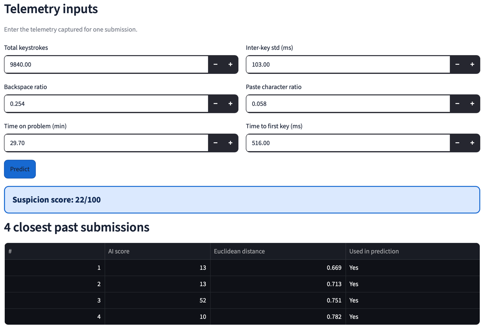
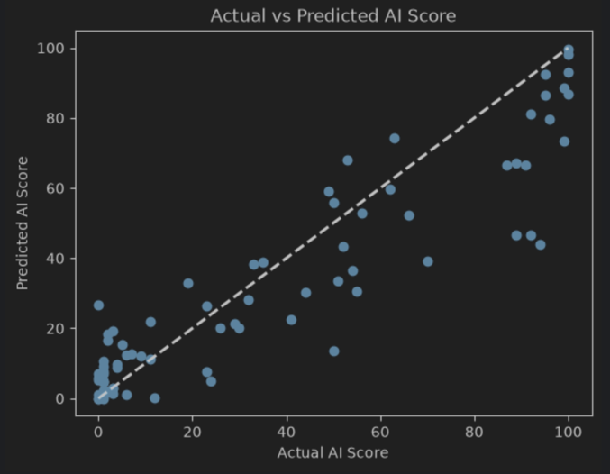
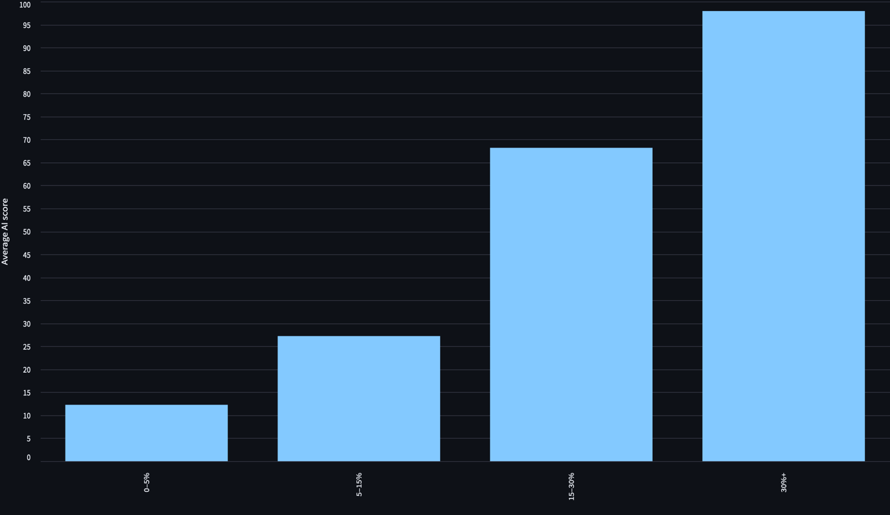
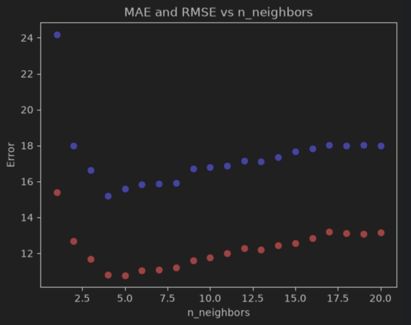

# AI Code Detector

A Streamlit app that gives a programming submission a **suspicion score from 0 to 100** for AI-generated code, based on how the code was typed, and shows the **4 most similar past submissions** so a grader can compare before acting.

**Live demo:** [aicodedetectorforut.streamlit.app](https://aicodedetectorforut.streamlit.app/)



## Why

A programming course suspected that some submissions were written with an AI model, and graders disagreed on how to spot them. Falsely accusing a student is serious, so the app is a review aid, not a verdict: it flags which submissions deserve a closer look and shows the evidence behind each score.

## Results

A K-nearest-neighbours regressor predicts the grader-assigned score with a **test MAE of 10.8 points** on a 0–100 scale.

| Model (test set, 76 submissions) | MAE | RMSE |
| --- | --- | --- |
| Baseline: always predict the training mean | 31.4 | 37.3 |
| KNN, all 22 features, k = 5 | 19.9 | 27.3 |
| **KNN, 6 selected features, k = 4 (final)** | **10.8** | **15.2** |

Feature selection roughly halved the error. KNN weighs every feature equally in its distance, so weak features made the "nearest" submissions similar mostly in noise.

RMSE is clearly above MAE, so a few predictions miss by a lot. That is why the app never shows a score without the neighbours behind it.



**Limitation:** the feature threshold and k were tuned on the same split that is reported as the test set, so 10.8 is optimistic. See [What I would change](#what-i-would-change).

## Data

`data-4.csv` holds 400 submissions. Each row is one programming submission: 18 numeric telemetry columns (keystrokes, typing rhythm, pauses, paste activity, timing, code style, runs), the editor used, and `ai_score`, a suspicion score from 0 (clearly hand-typed) to 100 (clearly pasted) assigned by senior graders.

Source: Dataset provided by the University of Twente

The strongest signal is pasting: the average score rises from 12 for submissions with under 5% pasted characters to 98 for those with over 30%.



## Method

**Cleaning** (400 rows, 20 columns → 380 rows, 6 features)

| Step | What | Why |
| --- | --- | --- |
| Inspect | Checked types and missing values | 0 missing, all types correct |
| Encode | One-hot encoded `editor_type` | KNN needs numeric input |
| Outliers | Removed rows outside 1.5 × IQR on `total_keystrokes` (20 rows) | Extreme values dominate KNN distances |
| Select features | Kept features with \|correlation\| ≥ 0.18 with `ai_score` | Weak features add noise to distances |

**Features kept**

| Feature | Meaning | Correlation |
| --- | --- | --- |
| `paste_char_ratio` | Share of characters that arrived by paste | +0.68 |
| `inter_key_std_ms` | Variability of typing rhythm | −0.43 |
| `total_keystrokes` | Keys pressed while solving | +0.26 |
| `time_to_first_key_ms` | Silence before the first key | −0.25 |
| `backspace_ratio` | Deleted keys per keystroke | −0.24 |
| `time_on_problem_min` | Minutes on the problem | −0.19 |

**Model:** `KNeighborsRegressor(n_neighbors=4)` with Euclidean distance on features scaled by a `StandardScaler` fitted on the training split only. 80/20 train/test split (`random_state=42`). The model and scaler are trained once and saved with `joblib`, so every user of the app gets the same model.

**Choosing k:** k was searched from 1 to 20. k = 4 has the lowest RMSE (15.19), and its MAE (10.81) is practically tied with k = 5 (10.78), so k = 4 was kept for fewer large misses.



## The app

- **Explore page:** query views (score by paste band, score by time on problem, typing-pattern quartiles, feature correlation, filtered rows) with a minimum-score slider and a range filter on any feature.
- **Predict page:** enter the six telemetry values; the input goes through the same scaler, the score is clipped to 0–100, and the 4 nearest past submissions are shown with their score and distance.

## Run locally

```bash
git clone https://github.com/nikitatalan/ai-code-detection.git
cd ai-code-detection
pip install -r requirements.txt
streamlit run main.py
```

## Project structure

```
main.py                Streamlit app (Explore and Predict pages)
notebook.ipynb         Cleaning, exploration, feature selection, training
data-4.csv             Raw dataset (400 submissions)
data-4-cleaned.csv     Cleaned dataset the app reads
knn_model.joblib       Trained KNN model
scaler.joblib          Fitted StandardScaler
requirements.txt
docs/                  Screenshots and charts for this README
```

## What I would change

- **Tune honestly.** Choose k and the feature threshold with cross-validation on the training data, and score the untouched test set once at the end.
- **Remove only impossible rows.** 11 of the 20 removed outliers had scores of 95–100, so the cleaning dropped some of the clearest AI cases. Meanwhile, 4 physically impossible rows stayed in (a longest typing stretch longer than the whole session).
- **Explain each score** by showing which features differ most from typical submissions.

## Team and my role

Group project for the Information Diamond module, University of Twente, 2026, by Nikita Talan, Andrii Zhornyak, Oleksandr Sysak and Dima Zhupanenko.

My part: data cleaning and analysis, including outlier handling, the feature-correlation analysis and feature selection, and tuning k.
